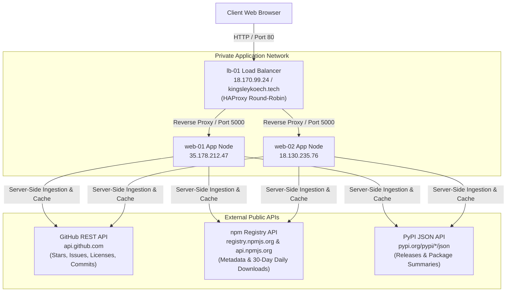

# Open Source Tech Radar & Package Health Explorer

> An intelligent, multi-ecosystem observability engine that evaluates, compares, and audits open-source software packages across **npm** and **PyPI** in real-time.

Built as the summative project for the African Leadership University (ALU) course **"Playing Around with APIs"** (100 pts).

**Live Production Cluster:** [http://kingsleykoech.tech](http://kingsleykoech.tech)  
**Author:** Kingsley Kipkoech (`k.kipkoech@alustudent.com`)  
**Repository:** [github.com/kingsleykipkoech/tech-radar](https://github.com/kingsleykipkoech/tech-radar)

---

## Architecture & Cluster Topology

The application is deployed across a distributed high-availability web cluster with dual application nodes behind an HAProxy load balancer:



---

## Key Features & User Interaction

1. **Multi-Ecosystem Search:** Instantly search packages across JavaScript/TypeScript (`npm`) and Python (`PyPI`).
2. **Multi-Faceted Filtering:**
   * **Ecosystem Filter:** All, npm, or PyPI.
   * **License Filter:** Permissive licenses (MIT, Apache 2.0, BSD, ISC) vs. Copyleft licenses (GPL, AGPL, MPL).
3. **Dynamic Sorting:**
   * 30-Day Download Volume ($\downarrow$)
   * GitHub Stars ($\downarrow$)
   * Algorithmic Health Score ($\downarrow$)
   * Recently Updated ($\downarrow$)
   * Fewest Open Issues ($\uparrow$)
4. **Interactive Data Visualizations:**
   * **30-Day Download Trajectory Sparkline:** Responsive SVG trend chart rendering daily download velocity.
   * **Algorithmic Health Meter (0–100):** Weighted multi-variable score evaluating community adoption (30%), release freshness (30%), issue debt ratio (20%), and license clarity (20%).
5. **Cluster Node Telemetry:** Live cluster status badge showing the exact active node (`X-Served-By: web-01` or `web-02`) responding to the browser request.

---

## APIs Consumed & Attribution

| API | Provider | Usage in Tech Radar | Authentication / Limits |
| :--- | :--- | :--- | :--- |
| **GitHub REST API** | GitHub, Inc. | Repository stars, forks, open issues count, commit velocity, and SPDX license identification. | Public / Rate-limited with server-side in-memory cache |
| **npm Registry & Download API** | npm, Inc. / GitHub | Package manifests, dependency trees, and daily download ranges over the last 30 days. | Public Open API |
| **PyPI JSON API** | Python Software Foundation | Package release timestamps, project summaries, classifiers, and documentation URLs. | Public Open API |

---

## Local Setup & Quickstart

### Prerequisites
* **Node.js** (v18.0.0 or higher)
* No third-party npm dependencies required (uses native Node.js standard library).

### Installation & Execution
```bash
# Clone repository
git clone https://github.com/kingsleykipkoech/tech-radar.git
cd tech-radar

# Run automated tests
npm test

# Start the application server
npm start
```
The server will start on `http://localhost:5000/`.

---

## Production Deployment Runbook

### 1. Backend Application Service (on `web-01` and `web-02`)
The application runs as a systemd service managed under `/etc/systemd/system/techradar.service`:

```ini
[Unit]
Description=Tech Radar Open Source Intelligence Node
After=network.target

[Service]
Type=simple
User=ubuntu
WorkingDirectory=/home/ubuntu/tech-radar
ExecStart=/usr/bin/node /home/ubuntu/tech-radar/server.js
Restart=always
RestartSec=5
Environment=PORT=5000
Environment=NODE_ENV=production
EnvironmentFile=-/home/ubuntu/tech-radar/.env

[Install]
WantedBy=multi-user.target
```

Enable and start the service:
```bash
sudo systemctl daemon-reload
sudo systemctl enable --now techradar
```

### 2. HAProxy Load Balancer Configuration (on `lb-01`)
In `/etc/haproxy/haproxy.cfg`:

```haproxy
frontend techradar_front
    bind *:80
    mode http
    default_backend techradar_back

backend techradar_back
    mode http
    balance roundrobin
    option httpchk GET /api/health
    http-check expect status 200
    server web-01 35.178.212.47:5000 check inter 2000 rise 2 fall 3
    server web-02 18.130.235.76:5000 check inter 2000 rise 2 fall 3
```

Reload HAProxy:
```bash
sudo service haproxy reload
```

---

## 2-Minute Demo Video Script & Storyboard

* **0:00 - 0:25 | Introduction & Problem Statement:** Introduce the application and author (Kingsley Kipkoech, ALU). Explain how Tech Radar allows developers to audit dependencies across npm and PyPI before adoption.
* **0:25 - 0:55 | Live Search & Health Score Analysis:** Search for `express` and `fastapi`. Highlight the dynamic 0–100 Health Score, GitHub stars, and open issues. Open the deep-dive modal to inspect the 30-day SVG download trend chart.
* **0:55 - 1:25 | Filter & Sort Demonstrations:** Filter by Permissive License (MIT/Apache), filter by Ecosystem (`npm` vs. `pypi`), and sort by 30-day downloads to show instant client-side reactivity.
* **1:25 - 1:50 | Distributed Infrastructure & Load Balancing:** Point to the top cluster telemetry badge showing the active serving node. Refresh the page to show HAProxy alternating requests between `web-01` and `web-02`.
* **1:50 - 2:00 | Conclusion & Rubric Wrap-up:** Thank the viewers and display repository links.

---

## License
MIT License © 2026 Kingsley Kipkoech
